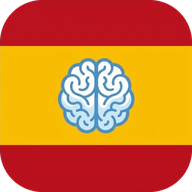

# Hablemos: Spanish for Clinicians



*Hablemos* means "let's talk." This web app helps English-speaking clinicians interview Spanish-speaking psychiatry patients. It is the Spanish/English sister app of [Usap Tayo](https://isaymotion.github.io/tagalog/) (Tagalog).

**App created by Isabella Navarro, MD. Latest version November 2026. isaymotion@gmail.com**

Version **0.11.0** (2026-11-19): Find the mistake (160 sentences), Listen and reply (120 items), lesson extras for all 91 lessons, 30 readings, 24 dialogues, 1,417 example sentences. Before it, 0.10.0: nurse track (6 sections, 125 phrases, nurse view in four tools, nurse pocket card), end-of-treatment review with four practice cases, nine new case simulations (16), admission MSE cases 9, discharge cases 9, interpretation drill 64. Before it, 0.9.0: listening practice (hear, dictation, 70 sound pairs, questions on dialogues and readings), level review test, example sentences for 1,197 dictionary words, ten more readings (20) and eight more dialogues (16), placement test of 30. 0.8.0 (2026-11-18): picture words (38 pictures, 505 words) with a printable body map, vocabulary quiz and topic matching, word pairs, numbers, dates and time, ten picture lessons (91 in all), extras for the 23 original lessons, and practice scores on Progress. 0.7.0 (2026-11-17): verb trainer, fill the blank, transform the sentence, sentence builder and 58 new grammar lessons (81 in all). 0.6.1: phone menu scrolls again. 0.6.0: the Usap Tayo engine with a Spanish language pack, all 27 interview sections (opening to closing, plus Shea's techniques), patient replies for every section and every tool, the interview flow handout, the MSE interviewer sheet, the clinical tools (mood episode checker, substance use screener, withdrawal and agitation guide with an opioid tab, de-escalation checklist, discharge assessment), the practice cases (seven case simulations, the interpretation drill, five discharge cases and two admission MSE cases) and the learn track (23 lessons, a 2,300-entry clinical dictionary, 10 readings, 8 dialogues, placement test), all draft for review.

## What it is

Hablemos gives the interviewer Spanish phrases for the psychiatric interview, each in two registers: *usted* (formal, `f`) and *tú* (familiar, `c`). The baseline is US and Mexican Spanish. Where wording differs by region (for example Caribbean, Central American or Andean usage), the phrase carries a regional variant in its note.

Every Spanish section is **Draft for review** until a native Spanish-speaking clinician has reviewed it. The notice stays on screen while a section carries `draft: true` (phrase sections) or a module's `REVIEWED` flag is false; clear it only after the review.

## Status and plan

| Pass | Content | State |
|---|---|---|
| 1 | Core interview phrases (opening and consent, HPI, mood, anxiety, psychosis, suicide and violence risk, substances, history, closing) | Done in 0.3.0: all 27 sections (draft for review) |
| 2 | Mental status exam: interviewer sheet, point-board replies, listening drill | Done in 0.3.0: MSE sections, two-page interviewer sheet, replies and listening drill for every section (draft for review) |
| 3 | Clinical tools: mood episode checker, substance use screener, withdrawal and agitation guide, de-escalation, discharge assessment, with the PHQ-9 and MDQ as interview paraphrases pointing to the published Spanish instruments | Done in 0.4.0 (draft for review) |
| 4 | Practice cases: case simulations, interpretation drill, discharge and admission MSE practice | Done in 0.5.0 (draft for review) |
| 5 | Spanish learn track: dictionary, lessons, reading, dialogues, placement | Done in 0.6.0 (draft for review) |
| 6 | Release with the audio pack | Pending |

## What's inside

The app shares its engine with Usap Tayo. The language pack `js/lang.js` sets voices, register labels, speech-recognition tag and quiz words; the engine reads `window.LANG` instead of hard-coding a language. Content lives in `js/data`.

| Section | What it does | Status |
|---|---|---|
| **Flashcards** | Spaced repetition with topic and psychiatry decks and an automatic "My mistakes" deck. | Live (draft for review) |
| **Psychiatry phrase sections** | Interview phrases by topic, each with usted and tú forms, a note and audio. | Live (draft for review) |
| **Point board** | The patient taps a reply, the phone speaks it and the interviewer reads the English. General replies, a 0 to 10 scale and likely replies for each interview section. | Live (draft for review) |
| **Listening drill** | Hear a patient or family reply, choose its meaning from four, then see the Spanish. | Live (draft for review) |
| **Case simulations** | Seven interactive interviews (psychosis, depression and suicide risk, mania, delirium, alcohol withdrawal, agitation, opioid use disorder) with feedback on every choice and an MSE summary, plus the interpretation drill (32 idioms of distress). | Live (draft for review) |
| **MSE interviewer sheet** | Printable pages of screening questions for the OPD and wards. | Live (draft for review) |
| **Substance use screener** | Alcohol, tobacco and vaping, cannabis, methamphetamine, cocaine, opioids and fentanyl, other substances and gambling: the DSM-5-TR criteria with severity and codes, AUDIT-C and Fagerström, a copyable chart line, motivational interviewing and a nurse script. | Live (draft for review) |
| **Mood episode checker** | Tap-to-count DSM-5-TR checker for depressive and manic episodes, with the PHQ-9 and MDQ items as interview paraphrases (use the published Spanish instruments for a documented score). | Live (draft for review) |
| **Withdrawal and agitation guide** | Alcohol (PAWSS, CIWA-Ar), cannabis, opioids (COWS, buprenorphine and methadone starts, naloxone) and the agitated patient, with Spanish patient-facing lines. | Live (draft for review) |
| **De-escalation checklist** | Twelve steps with Spanish phrases, a rapid drill, what to do if it fails, a chart note and an A6 pocket card. | Live (draft for review) |
| **Discharge assessment and practice** | Guided field-by-field discharge interview with documentation picks, and five simulated patients to practise on with a discharge-or-defer decision. | Live (draft for review) |
| **Admission MSE practice** | Two simulated admission interviews (Mateo, Brayan) checked against a model MSE, with an admission vs discharge comparison. | Live (draft for review) |
| **Printable handouts** | PDF or print of the interview flow, MSE, de-escalation checklist and pocket card, and discharge guide, with English shown, hidden or as an answer key. | Live (draft for review) |
| **Dictionary, lessons, reading, dialogues, placement** | Clinical Spanish dictionary (about 2,300 entries, root lookup), 91 lessons with quizzes from A1 to B2 (a level filter, a review lesson per level), 20 graded readings, 16 dialogues to listen, shadow and role-play, and a 30-question placement test. | Live (draft for review) |
| **Verb trainer** (0.7.0) | 154 verbs (A1 41, A2 45, B1 30, B2 10, clinical 28) with every form built by rule in `js/conjugate.js`, example sentences, and three drills: choose, name or type the form. Command and "let's" forms of self-harm verbs are never built. Route `#/verbs`. Data `js/data/verbs.js` (append only: the position is the id). | Live (draft for review) |
| **Fill the blank** (0.7.0) | 345 sentences (A1 100, A2 105, B1 80, B2 60), 5 per grammar lesson, by level or by lesson, with the reason after each answer. Route `#/cloze`. Data `js/data/grammar-cloze-*.js`. | Live (draft for review) |
| **Transform the sentence** (0.7.0) | 160 items (40 per level): choose the right version or type it. Route `#/transform`. Data `js/data/grammar-transform-1.js`. | Live (draft for review) |
| **Sentence builder** (0.7.0) | Put the words of a sentence from the lessons, dialogues, readings and drills back in order. Route `#/build`. No data of its own. | Live (draft for review) |
| **Picture words and body map** (0.8.0) | 38 pictures in nine groups with 505 words: tap to learn, Identify, Label it (choose or type), Listen and point, print sheets. The body map lets a patient tap where it hurts and prints as a handout. Routes `#/pictures`, `#/pictures/<id>`, `#/pictures/bodymap`. Data `js/data/picture-sets-*.js`, `js/data/picture-bodymap.js`; line art in `pictures/art-*.js` (no words, so it does not start the audio job). | Live (draft for review) |
| **Vocabulary quiz and topic matching** (0.8.0) | Dictionary decks as Meaning, Recall, In context and Type it; 19 topic sets (336 words) to match or quiz. Route `#/vocab`, `#/vocab?tab=match`. Data `js/data/topic-sets.js`. | Live (draft for review) |
| **Word pairs** (0.8.0) | 280 pairs (70 per level): opposites, similar words, collocations. Learn, match, quiz. Route `#/pairs`. Data `js/data/word-pairs-1.js`, `-2.js`. | Live (draft for review) |
| **Numbers, dates and time** (0.8.0) | 12 groups (142 rows) to read and hear, 40 clinic listening sentences. Route `#/numbers`. Data `js/data/numbers.js`. | Live (draft for review) |
| **Find the mistake** (0.11.0) | Tap the one wrong word of a sentence; the corrected sentence is shown and spoken, the wrong one never. Route `#/errors` (`js/errors.js`), data `GRAMMAR_ERRORS` in `js/data/grammar-errors-<level>.js` (ids `e-<lv>-NNN`). | Live (draft for review) |
| **Listen and reply** (0.11.0) | Hear a line, choose the natural reply among four. Route `#/reply` (`js/reply.js`), data `LISTEN_REPLY` in `js/data/listen-reply-*.js` (ids `r-NNN`, `clin` true or false). Both drills run on `App.drillRun` (`js/drillrun.js`). | Live (draft for review) |
| **Nurse track** (0.10.0) | Resident / Nurse switch (`settings.role`) on the Psychiatry page; six nurse sections (`js/data/psych-phrases-nurse.js`, `role: 'nurse'`), nurse scripts in De-escalation, Discharge, Mood episode and the MSE sheet (`js/nurse-script.js`, `PSYCH_NURSE_TOOLS` in `psych-nurse-tools*.js`), three nurse case simulations, nurse pocket card (`#/psych/handout?nursecard=1`). | Live (draft for review) |
| **End-of-treatment review** (0.10.0) | Outpatient last-session review: form `PSYCH_EOT` (`js/data/psych-eot.js`, section `eot`), cases `PSYCH_EOT_CASES` (`psych-eot-cases-*.js`), routes `#/psych/eot`, `#/psych/ecase/<id>` (`js/eot-practice.js` on the discharge practice engine). | Live (draft for review) |
| **Listening practice** (0.9.0) | Hear (words or sentences by level), Dictation, Sound pairs (70), Dialogues and readings with listening questions (36 texts, 124 questions). Route `#/listen`. Data `js/data/sound-pairs.js`, `listen-questions*.js`. | Live (draft for review) |
| **Level review test** (0.9.0) | A mixed test per level (grammar, verbs, vocabulary, listening, reading), built from the existing data; timer, resume, score by area. Route `#/test`. | Live |
| **Dictionary example sentences** (0.9.0) | 1,197 sentences (`js/data/examples-1.js` to `-4.js`), shown on the word page and card back. | Live (draft for review) |
| **Lesson extras** (0.8.0) | Common mistakes, more examples and a More practice quiz for the 23 original lessons. Data `js/data/lesson-extra-1.js`, `-2.js`. | Live (draft for review) |

## Publish it with GitHub Pages

1. On GitHub, open **Settings → Pages**.
2. Under **Build and deployment**, choose **Deploy from a branch**, branch **main**, folder **/ (root)**, then **Save**.
3. After a minute the app is live at `https://isaymotion.github.io/Hablemos/`. The repository is `isaymotion/Hablemos`.
4. On a phone, open that link, then use **Add to Home Screen** (iPhone Safari) or **Install app** (Android Chrome).

To try it locally: run `python3 -m http.server` in this folder and open `http://localhost:8000`. Opening `index.html` directly also works, but offline mode needs a web server.

## Audio pack (natural Spanish voice)

Device voices vary in quality, so the app plays recorded clips from `audio/` whenever they exist.

The clips are made by a GitHub Actions job (`.github/workflows/audio-pack.yml`) that records every Spanish string the app can speak with Microsoft neural voices through the open-source `edge-tts` client: `es-MX-DaliaNeural` and `es-MX-JorgeNeural` (Mexican Spanish, female and male) and `es-US-PalomaNeural` (US Spanish). The job writes `audio/manifest.json` and one `<16-hex>.mp3` per string. The file name is a hash of the text, defined in `js/audio-key.js`. The job runs by itself when files in `js/data/` change.

Without the pack, the app uses a Spanish device voice if one is installed.

## Adding content

All content lives in plain JavaScript files under `js/data/`. No build step. The formats are the same as in the Usap Tayo README: in phrase objects `{ en, tl, f, c, n }`, `tl` holds the Spanish text, `f` the usted form, `c` the tú form and `n` a note.

| File | Contents |
|---|---|
| `meta.js` | Placement test |
| `dict-core.js`, `dict-everyday.js`, `dict-clinical.js`, `dict-more.js` | Dictionary (`spanish | english | pos | category | root | note` lines) |
| `lessons.js`, `lessons-2.js` to `lessons-6.js`, `lessons-zz-order.js`, `reading.js`, `dialogues.js` | Lessons (91; new lesson ids also go in the ORDER list of `lessons-zz-order.js`), readings, dialogues |
| `grammar-cloze-*.js`, `grammar-transform-1.js`, `verbs.js` | Fill the blank, Transform the sentence, verb trainer (ids are permanent: append only) |
| `examples-*.js`, `sound-pairs.js`, `listen-questions*.js`, `reading-2.js`, `dialogues-2.js` | Dictionary example sentences (`[headword\|English, es, en, level, hit?]`), sound pairs, listening questions, the 0.9.0 readings and dialogues |
| `picture-sets-*.js`, `picture-bodymap.js`, `topic-sets.js`, `word-pairs-*.js`, `numbers.js`, `lesson-extra-*.js` | Picture words and body map, topic matching sets, word pairs, numbers, lesson extras (ids are permanent: append only) |
| `psych-phrases.js` | Interview phrase sections |
| `psych-shea.js` | Validity-technique phrases and links to the Psychiatric Interviewing Trainer |
| `psych-answers.js` | Point-board replies per interview section |
| `psych-cases.js`, `psych-cases-<id>.js`, `psych-interp-2.js` | Case simulations (16; `role: 'nurse'` on nurse cases) and interpretation items (64) |
| `psych-flow.js` | Handout order, pocket-card phrases and MSE domains |
| `psych-mse-sheet.js` | MSE interviewer sheet |
| `psych-mood.js` | Mood episode checker, PHQ-9 and MDQ |
| `psych-sud.js` | Substance use screening and brief intervention |
| `psych-withdrawal.js` | Withdrawal and agitation guide |
| `psych-deesc.js` | De-escalation checklist |
| `psych-discharge.js` | Discharge assessment |
| `psych-discharge-cases.js`, `psych-discharge-cases-<id>.js`, `psych-mse-cases-<id>.js`, `psych-eot-cases-<id>.js` | Discharge (9), admission MSE (9) and end-of-treatment (4) practice cases, one file per new patient |
| `psych-admit-mse.js` | Admission MSE practice |
| `psych-mse-cases.js` | MSE practice cases |

## Version convention

Use semver. The version appears in three places and all three must agree: `data/app-meta.js`, the newest entry of `APP_CHANGELOG` in `data/changelog.js`, and the cache name in `sw.js` (`hablemos-X.Y.Z`). Bump all three on every release so installed copies pick up the update. The service worker deletes only caches whose names start with `hablemos-`; never change that rule, because every isaymotion app shares the same site.

## Important note on clinical content

Spanish phrases are practice phrasings written for training. They are not validated translations of research instruments. Use published validated Spanish versions of the PHQ-9, MDQ and other instruments, and confirm wording with a native Spanish-speaking clinician, supervisors and patients. Doses in the withdrawal guide are typical adult doses and must be checked against the hospital protocol. Do not put patient data in this repository.

Crisis line in the US: **988 Suicide and Crisis Lifeline**. Call or text 988; Spanish is available. Set local crisis numbers for your site in `data/hospital.js`.

## Project structure

```
index.html              App shell
manifest.webmanifest    Install metadata
sw.js                   Offline cache
css/style.css           Styles
data/app-meta.js        Name, version, attribution
data/changelog.js       What's New (APP_CHANGELOG)
data/hospital.js        Hospital and program constants, local crisis numbers
icons/                  App icons
js/lang.js              Language pack
js/audio-key.js         Hash key for audio clips
js/                     Engine: core, views, psych-views, point-listen, handout, mse-sheet, sud, mood, withdrawal, deesc, discharge, mse-practice, app
js/data/                All content
```
